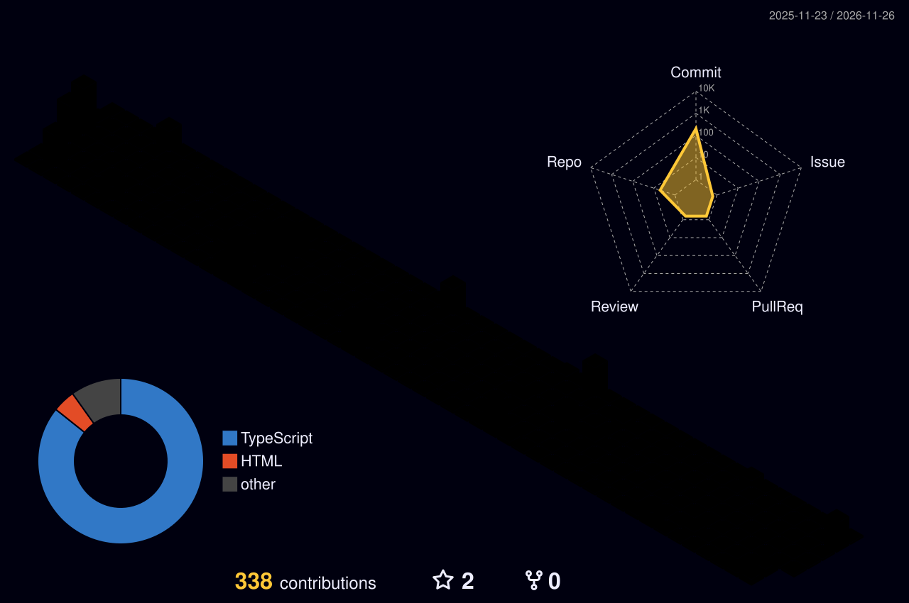

  

  

  
  
  

---

### About me

- 🏢 **Founder, DexLanka Software Solutions**: websites, web apps, POS systems and mobile apps for small and growing businesses
- 💼 **Full Stack Developer, Marpak Private Limited**: Laravel platforms, React front-ends and iOS/Android apps for overseas clients
- 🎓 **BEng (Hons) Software Engineering**, IIC University of Technology (2025), studied at Java Institute for Advanced Technology
- 📍 Based in **Sri Lanka**, open to freelance projects and collaborations

### Tech stack

**Frontend** 

**Mobile** 

**Backend &amp; data** 

**Tools** 

### Featured work

| Project | What it is | Live |
|---|---|---|
| **iMobile Service Center** | Customer website plus service-center POS for a mobile repair business (React, TypeScript, Express, Supabase) | [imobileservicecenter.lk](https://imobileservicecenter.lk) |
| **Omniworld Trading** | Company website for a Sri Lankan trading business | [omniworldtrading.com](https://omniworldtrading.com) |
| **Garment production system** | Production and quality-inspection tracking system for a uniform manufacturer | Private client project |
| **DexLanka** | Company site for my software studio | [dexlanka.com](https://dexlanka.com) |
| **Art Gallery** | Gallery website, my first client project | [View site](https://rashmitharkl.github.io/Art-Gallery) |

### Contribution activity

  <picture>
    <source media="(prefers-color-scheme: dark)" srcset="./profile-3d-contrib/profile-night-rainbow.svg"/>
    <source media="(prefers-color-scheme: light)" srcset="./profile-3d-contrib/profile-gitblock.svg"/>
    
  </picture>

  <picture>
    <source media="(prefers-color-scheme: dark)" srcset="https://raw.githubusercontent.com/rashmithaRKL/rashmithaRKL/output/github-snake-dark.svg"/>
    <source media="(prefers-color-scheme: light)" srcset="https://raw.githubusercontent.com/rashmithaRKL/rashmithaRKL/output/github-snake.svg"/>
    
  </picture>

### Services

Business websites · Web apps &amp; dashboards · POS &amp; inventory systems · iOS/Android apps (React Native, Flutter)

**Have a project in mind?** Reach me at [dexlanka.com](https://dexlanka.com) or [kalhararashmitha@gmail.com](mailto:kalhararashmitha@gmail.com).

  

