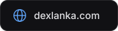
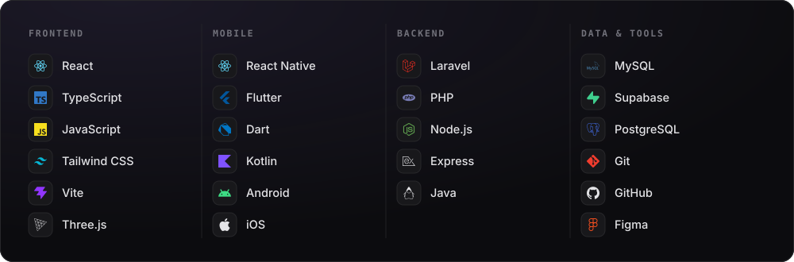
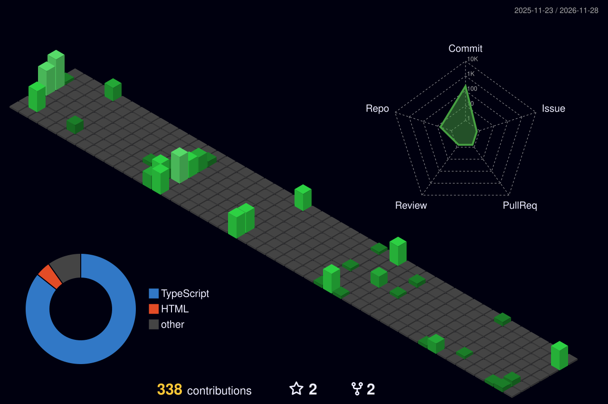

  

  &nbsp;
  &nbsp;
  

### About

I'm a software engineer from Sri Lanka and the founder of **[DexLanka Software Solutions](https://dexlanka.com)**, where I build websites, POS systems and mobile apps for businesses. I also work as a **Full Stack Developer at Marpak Private Limited**, building Laravel platforms, React front-ends and iOS/Android apps for overseas clients.

- BEng (Hons) Software Engineering, IIC University of Technology (2025)
- Open to freelance projects and collaborations

### Tech stack

### Featured work

  
  

  
  

### Contributions

<picture>
  <source media="(prefers-color-scheme: dark)" srcset="./profile-3d-contrib/profile-night-green.svg"/>
  <source media="(prefers-color-scheme: light)" srcset="./profile-3d-contrib/profile-green.svg"/>
  
</picture>
